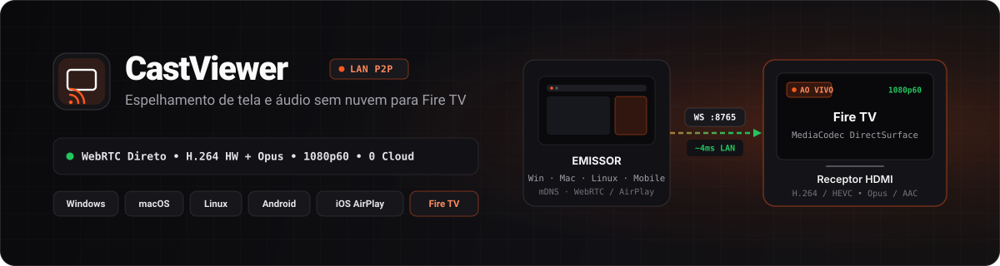
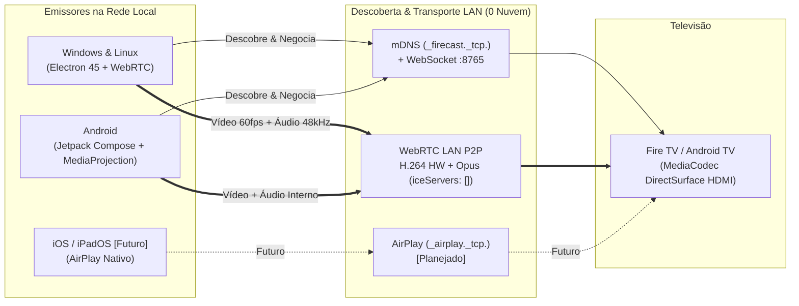

<div align="center">

<a href="https://github.com/EduardoCoura/castviewer">
  
</a>

<br/><br/>

**Espelhamento de tela e áudio 100% em rede local (LAN) via WebRTC P2P — sem nuvem, sem lag, sem cabos e sem driver virtual.**

<br/>

[](https://github.com/EduardoCoura/castviewer/releases/latest)
[](./LICENSE)
[](https://github.com/EduardoCoura/castviewer/actions/workflows/build-linux.yml)
[](#downloads)

<br/>

[Downloads](#-downloads) •
[Por que usar?](#-por-que-o-castviewer) •
[Recursos](#-recursos-por-plataforma) •
[Arquitetura](#-arquitetura-zero-cloud) •
[Roadmap (iOS AirPlay)](#%EF%B8%8F-roadmap--implementações-futuras) •
[Compilar](#%EF%B8%8F-como-compilar-do-código-fonte)

</div>

---

## 🎯 Por que o CastViewer?

Espelhar PC ou celular na Fire TV normalmente exige nuvem, cabos HDMI, drivers virtuais pesados (como VB-CABLE) ou sofre com segundos inteiros de atraso. O **CastViewer** resolve isso com uma arquitetura direta ponto-a-ponto dentro do seu próprio Wi-Fi ou cabo de rede:

- **⚡ Latência ultrabaixa (~4 ms na LAN):** vídeo H.264 acelerado por hardware (`MediaCodec` DirectSurface no Fire TV) e áudio Opus direto via **WebRTC LAN P2P** (`iceServers: []`, zero STUN/TURN externo).
- **🎧 Áudio interno nativo sem gambiarras:** captura direta do áudio do sistema no **Windows** (WASAPI loopback), **Linux** (PipeWire nativo + fallback `parec`/PulseAudio) e **Android** (`AudioPlaybackCapture`), com botão para silenciar os alto-falantes do notebook enquanto transmite.
- **🔒 Privacidade e controle total:** descoberta automática via mDNS (`_firecast._tcp.`) e sinalização WebSocket na porta `8765` — nenhum byte sai da sua rede local.
- **🎬 Recursos extras práticos:** troca instantânea entre **Tela** e **Janela** ao vivo sem desconectar, **Clip Replay 30s (MP4)**, **Print instantâneo**, **Pausa com congelamento de quadro** e **Takeover inteligente** (quem está na TV pode aprovar ou recusar quando outra pessoa pedir para assumir).

---

## 📦 Downloads

Baixe o pacote pronto para cada dispositivo na [**Release v1.0.0**](https://github.com/EduardoCoura/castviewer/releases/tag/v1.0.0):

| Dispositivo | Versão | Pacote / Instalador | Download Direto |
| :--- | :---: | :--- | :--- |
| **Fire TV / Android TV** | `v2.4` | APK Receptor (obrigatório na TV) | [**`CastViewer-FireTV-v2.4.apk`**](https://github.com/EduardoCoura/castviewer/releases/download/v1.0.0/CastViewer-FireTV-v2.4.apk) |
| **Windows (x64)** | `v1.0.0` | Instalador (`.exe`) • Portátil (`.exe`) | [**Setup `.exe`**](https://github.com/EduardoCoura/castviewer/releases/download/v1.0.0/CastViewer.Setup.1.0.0.exe) • [**Portátil `.exe`**](https://github.com/EduardoCoura/castviewer/releases/download/v1.0.0/CastViewer-Portable-1.0.0.exe) |
| **Linux (x64)** | `v1.0.0` | Universal (`AppImage`) • Debian/Ubuntu (`.deb`) • `.tar.gz` | [**`.AppImage`**](https://github.com/EduardoCoura/castviewer/releases/download/v1.0.0/CastViewer-Linux-1.0.0-x86_64.AppImage) • [**`.deb`**](https://github.com/EduardoCoura/castviewer/releases/download/v1.0.0/CastViewer-Linux-1.0.0-amd64.deb) • [**`.tar.gz`**](https://github.com/EduardoCoura/castviewer/releases/download/v1.0.0/CastViewer-Linux-1.0.0-x64.tar.gz) |
| **Android (Mobile)** | `v1.7.4` | APK Emissor (`Android 8.0+`) | [**`CastViewer-Android-v1.7.4.apk`**](https://github.com/EduardoCoura/castviewer/releases/download/v1.0.0/CastViewer-Android-v1.7.4.apk) |

<details>
<summary><b>🐧 Guia rápido de instalação no Linux (Ubuntu, Debian, Fedora, Arch, Mint...)</b></summary>

<br/>

**Opção 1 — Debian / Ubuntu / Pop!_OS / Mint (`.deb`):**
```bash
sudo apt install ./CastViewer-Linux-1.0.0-amd64.deb
castviewer
```

**Opção 2 — Qualquer distro (`AppImage`):**
```bash
chmod +x CastViewer-Linux-1.0.0-x86_64.AppImage
./CastViewer-Linux-1.0.0-x86_64.AppImage
```
> **Dica para Ubuntu 24.04+:** caso o AppArmor restrinja o sandbox local em AppImages, execute com `./CastViewer-Linux-1.0.0-x86_64.AppImage --no-sandbox` ou utilize o pacote `.deb`.

**Notas de Sessão e Áudio:**
- **X11:** prévia e troca direta de telas e janelas na grade da interface.
- **Wayland:** usa o seletor nativo do sistema via Portal PipeWire (`WebRTCPipeWireCapturer`) ao iniciar a transmissão.
- **Áudio do sistema:** captura nativa via PipeWire (`loopback-capture`) com fallback automático para `parec` (PulseAudio), além de silenciamento do PC via `pactl`/`wpctl` e Play/Pause remoto via `playerctl`.

</details>

---

## ✨ Recursos por Plataforma

| Plataforma | Módulo | Status | Destaques |
| :--- | :--- | :---: | :--- |
| **Fire TV / Android TV** | [`firestick-app/`](./firestick-app) | ✅ **Ativo (`v2.4`)** | Receptor Kotlin com decodificação por hardware (`MediaCodec` / H.264 / VP8), QR Code na tela, áudio HDMI media-stream e overlay de solicitação de troca. |
| **Windows** | [`desktop-sender/`](./desktop-sender) | ✅ **Ativo (`v1.0.0`)** | Electron 45 com captura DXGI/WGC 1080p60+, áudio loopback WASAPI sem VB-CABLE, mute de alto-falantes, auto-detecção de GPU (NVIDIA/AMD/Intel/Hybrid), Modo PC Fraco/Pouca RAM, Clip Replay 30s MP4 e Play/Pause remoto. |
| **Linux** | [`desktop-sender/`](./desktop-sender) | ✅ **Ativo (`v1.0.0`)** | Compatível com **X11 e Wayland/PipeWire**, loopback nativo PipeWire + fallback `parec`, mute via `pactl`/`wpctl`, Play/Pause MPRIS, pacotes `.AppImage`, `.deb` e `.tar.gz`. |
| **Android** | [`android-sender/`](./android-sender) | ✅ **Ativo (`v1.7.4`)** | App Jetpack Compose / Material 3 com `MediaProjection` + áudio interno (`AudioPlaybackCapture`), bolha flutuante externa para pausar/encerrar/gravar sobre qualquer app, Modo AMOLED, Quick Tile e Replay 30s. |
| **iOS / iPadOS (via AirPlay)** | `Roadmap` | 🗓️ **Implementação Futura** | Planejado para conectar iPhone e iPad diretamente via protocolo **AirPlay** na mesma rede local, sem exigir app adicional no iOS. |

---

## 🌐 Arquitetura Zero-Cloud



> 📖 Quer entender os detalhes do protocolo de mensagens e identidade visual? Veja [`PROTOCOL.md`](./PROTOCOL.md) e [`DESIGN_SYSTEM.md`](./DESIGN_SYSTEM.md).

---

## 🗺️ Roadmap & Implementações Futuras

> **Nota de transparência:** os itens abaixo ainda **não estão disponíveis** na versão atual (`v1.0.0` / `v2.4`), fazendo parte do plano de evolução do projeto.

- [ ] **🍎 Suporte a iOS / iPadOS via AirPlay (Implementação Futura):**
  - Integração de receptor compatível com **AirPlay** no módulo da TV (`_airplay._tcp.` via mDNS/RTSP/mirroring na LAN), permitindo que usuários de **iPhone e iPad** espelhem tela e áudio nativamente pela **Central de Controle (Espelhar Tela)** sem precisar instalar nenhum aplicativo na App Store nem depender da internet.
- [ ] **🐧 Wayland Session Persistence:** suporte a restauração automática de token de sessão ScreenCast no PipeWire (`RestoreToken`) para evitar reconfirmar a tela ao alternar fontes no Wayland.
- [ ] **🍏 macOS Desktop Sender:** empacotamento `.dmg` universal (`arm64` / `x64`) para `desktop-sender/`.

---

## 🛠️ Como Compilar do Código-Fonte

<details>
<summary><b>1. Desktop Sender (Windows & Linux — Node.js / Electron 45)</b></summary>

```bash
cd desktop-sender
npm install
npm run check

# Build Windows (.exe Setup, Portátil e dir)
npm run dist:win

# Build Linux (.AppImage, .deb e .tar.gz)
npm run dist:linux
```

</details>

<details>
<summary><b>2. Android Sender (Android Studio / Gradle)</b></summary>

```bash
cd android-sender
./gradlew testDebugUnitTest assembleDebug
```

</details>

<details>
<summary><b>3. Fire TV / Android TV Receiver (Gradle)</b></summary>

```bash
cd firestick-app
./gradlew testDebugUnitTest assembleDebug
```

</details>

---

## 🤝 Contribuição & Licença

Contribuições, sugestões de melhoria e pull requests são muito bem-vindos!

- Distribuído sob a licença **GNU General Public License v3.0 (GPL-3.0)** — veja o arquivo [`LICENSE`](./LICENSE) para o texto completo.

<div align="center">

<br/>

Se o **CastViewer** ajudou você a espelhar sua tela na Fire TV sem lag, considere deixar uma **⭐ Star** no repositório — isso ajuda muito o projeto a alcançar mais pessoas!

</div>
