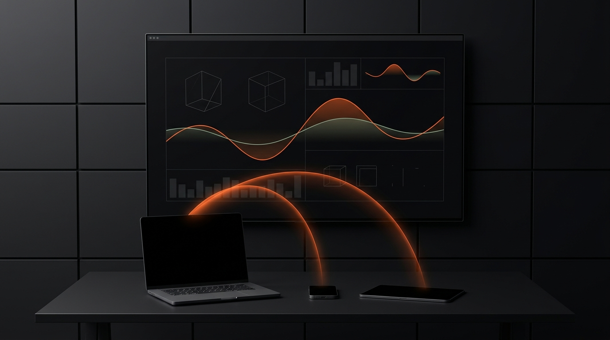
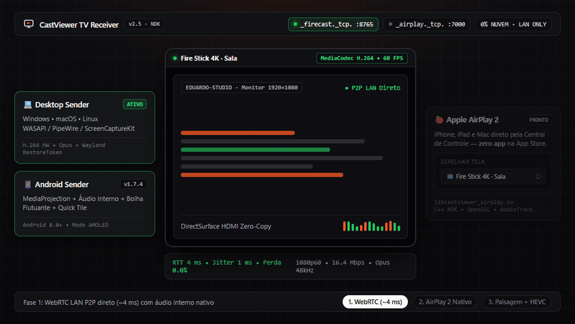
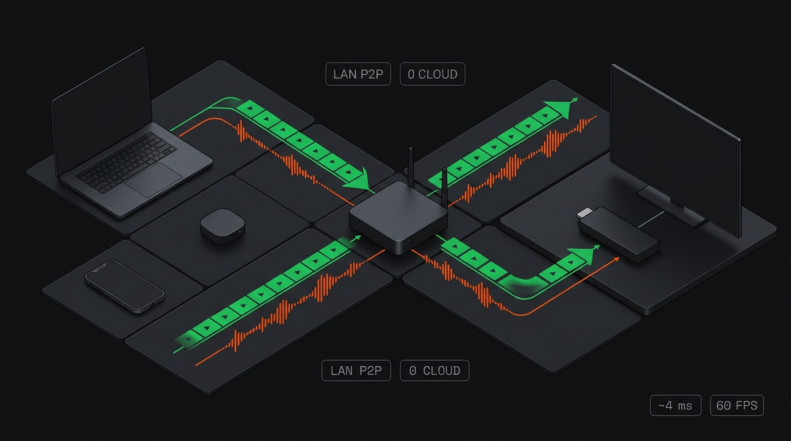
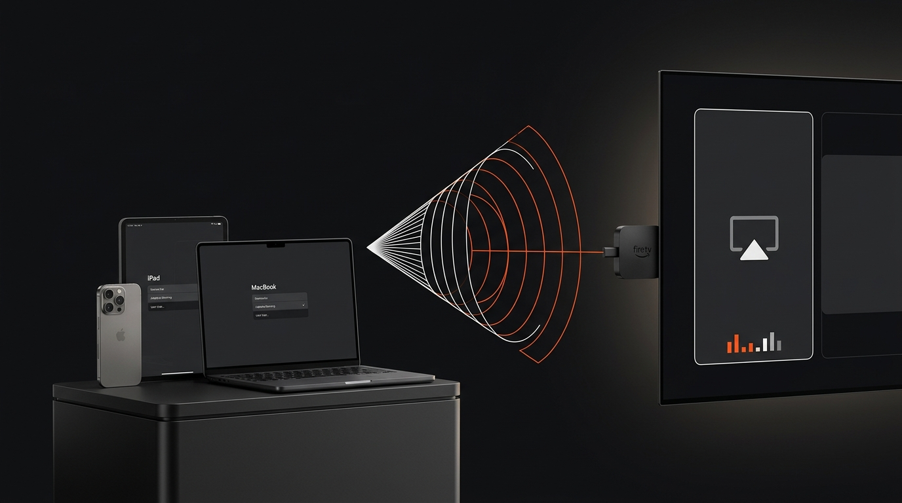
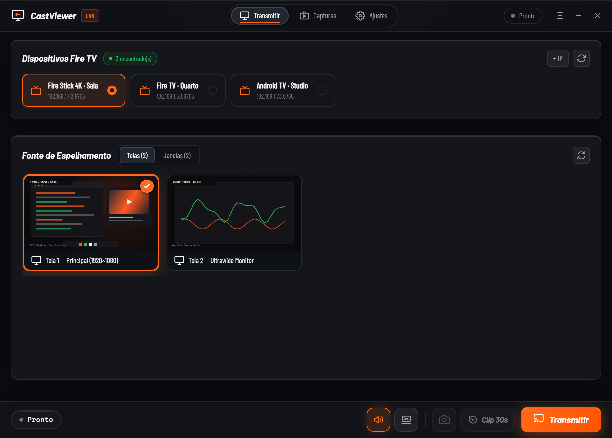
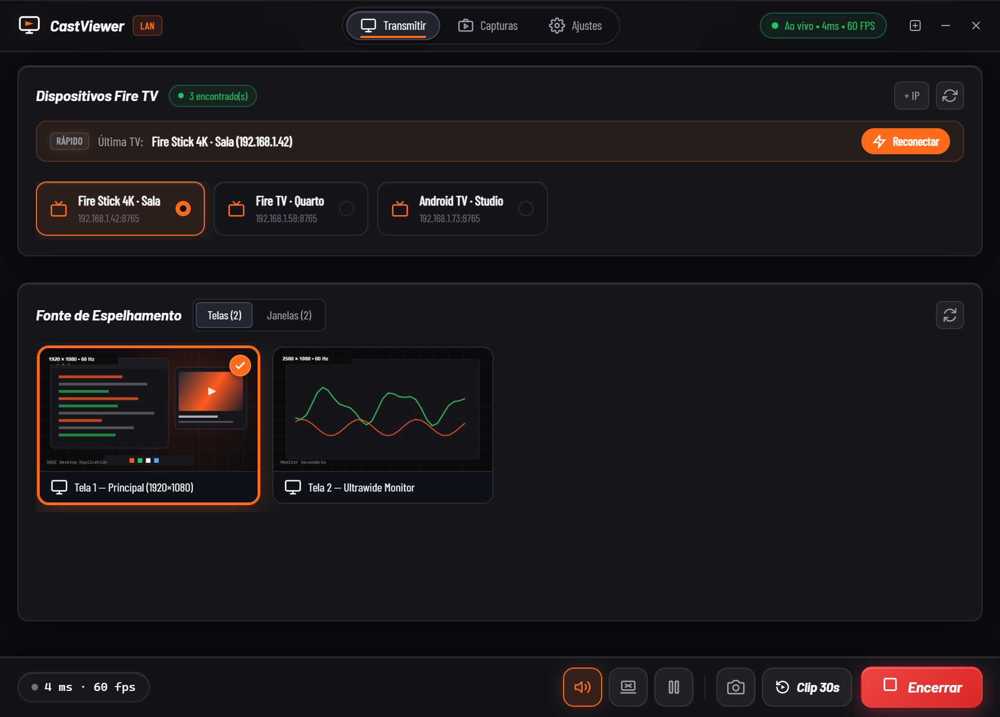
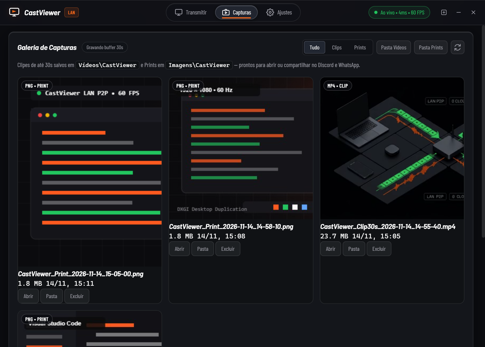
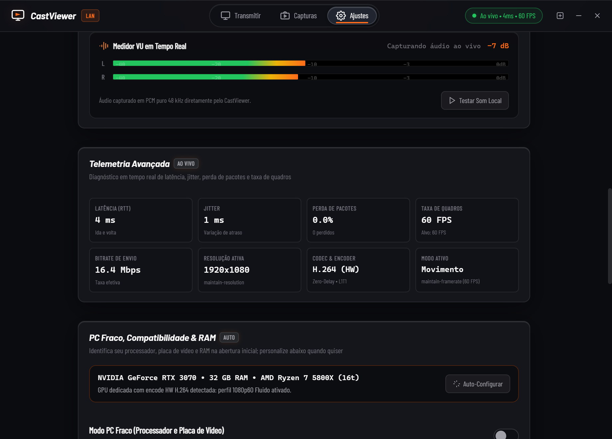
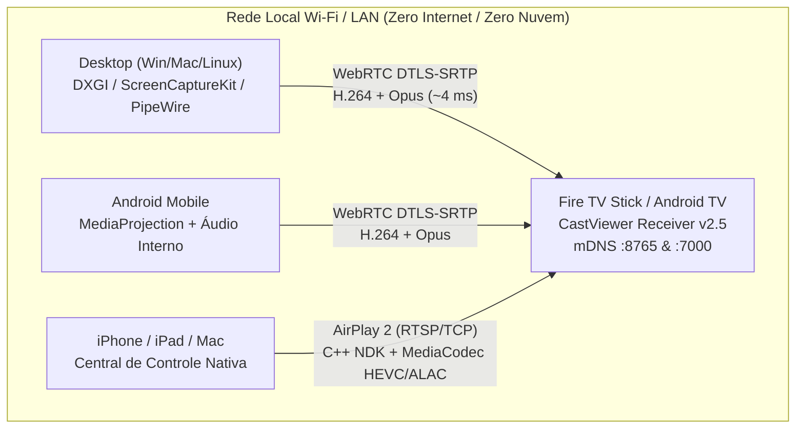

<div align="center">



<br /><br />

# CastViewer

**Espelhamento de tela e áudio P2P ultrarrápido na rede local (`~4 ms`, `1080p60`), com Receptor WebRTC e Apple AirPlay 2 nativo embutido no Fire TV.**

*Zero nuvem. Zero assinatura. Código aberto do remetente ao decodificador HDMI.*

<br />

[](https://github.com/EduardoCoura/castviewer/releases/latest)
[](PROTOCOL.md)
[](#arquitetura-zero-cloud)
[](LICENSE)

<br />

[](https://github.com/EduardoCoura/castviewer/actions/workflows/build-windows.yml)
[](https://github.com/EduardoCoura/castviewer/actions/workflows/build-macos.yml)
[](https://github.com/EduardoCoura/castviewer/actions/workflows/build-linux.yml)
[](https://github.com/EduardoCoura/castviewer/actions/workflows/build-android.yml)

<br />

[Demonstrações](#vídeos-de-demonstração) •
[Como Funciona](#como-funciona-por-baixo-do-capô) •
[Interface](#galeria-da-interface) •
[Downloads](#downloads) •
[Arquitetura](#arquitetura-zero-cloud) •
[Compilar](#como-compilar-localmente)

</div>

---

## Por que o CastViewer existe?

Soluções comuns de espelhamento comprimem imagem em excesso, travam o áudio no alto-falante do computador, exigem instalação de drivers virtuais (`VB-CABLE`) ou cobram mensalidade para liberar 1080p60 e suporte a iPhone/Mac.

O **CastViewer** implementa um pipeline ponta a ponta focado em latência mínima dentro da sua própria rede Wi-Fi / LAN:

- **Zero servidores externos (`iceServers: []`)**: sinalização WebSocket local na porta `8765` com descoberta automática via **mDNS / Bonjour** — o tráfego de vídeo e áudio nunca sai do seu roteador.
- **Receptor Dual-Engine no Fire TV / Android TV**: aceita **WebRTC LAN P2P** (`Desktop` e `Android`) e **Apple AirPlay 2 Nativo** (`C++ NDK` com OpenSSL + `MediaCodec` em hardware) no mesmo APK.
- **Áudio Interno Nativo (`PCM 48 kHz`)**: captura o som direto do sistema (`WASAPI Loopback`, `PipeWire / PulseAudio`, `ScreenCaptureKit`, `AudioPlaybackCapture`) sem cabo virtual, com opção de **silenciar apenas o notebook** mantendo o som cheio na TV.
- **Recursos de Estúdio no Desktop**: troca instantânea entre monitores e janelas ao vivo, **Print 1-clique**, **Buffer de Replay dos últimos 30s** (`Clip 30s`), medidor **VU estéreo** e auto-ajuste para **GPU dedicada ou PC Fraco**.

---

## Vídeos de Demonstração

<table>
  <tr>
    <td align="center" width="50%">
      <strong>Desktop Sender — Fluxo Completo &amp; Replay 30s</strong>
      <br /><br />
      
      <br /><br />
      <sub>Descoberta mDNS 1-clique, troca para VS Code com transição cinemática, silenciamento só do notebook, galeria com Print/Clip 30s e telemetria a 4 ms / 60 FPS.<br /><a href="docs/assets/demo-desktop-cast.mp4">Abrir versão MP4</a></sub>
    </td>
    <td align="center" width="50%">
      <strong>Ecossistema &amp; Takeover Apple AirPlay 2</strong>
      <br /><br />
      
      <br /><br />
      <sub>Descoberta paralela <code>_firecast._tcp.</code> + <code>_airplay._tcp.</code> com takeover automático ao espelhar um iPhone, iPad ou Mac direto pela Central de Controle.<br /><a href="docs/assets/demo-ecosystem-airplay.mp4">Abrir versão MP4</a></sub>
    </td>
  </tr>
</table>

---

## Como Funciona por Baixo do Capô

<table>
  <tr>
    <td width="50%" valign="top">
      
      <br /><br />
      <h3>Motor 1 — WebRTC Zero-Cloud LAN</h3>
      <ul>
        <li><strong>Descoberta Automática</strong>: serviço mDNS <code>_firecast._tcp.</code> na porta <code>8765</code> sem precisar digitar IPs (com fallback manual por IP/histórico 1-clique).</li>
        <li><strong>Vídeo de Baixíssimo Atraso</strong>: H.264 Baseline/Constrained zero-delay em <strong>1080p60</strong> (ou perfis <em>720p60</em> / <em>PC Fraco</em>) enviado via DTLS-SRTP direto na LAN.</li>
        <li><strong>Áudio Opus + Loopback Nativo</strong>: <code>PCM 48 kHz</code> injetado via <code>AudioWorklet</code> com modulação em tempo real no medidor VU L/R e controle independente do alto-falante local.</li>
      </ul>
    </td>
    <td width="50%" valign="top">
      
      <br /><br />
      <h3>Motor 2 — Apple AirPlay 2 em C++ NDK</h3>
      <ul>
        <li><strong>Zero App na App Store</strong>: anuncia <code>_airplay._tcp.</code> e <code>_raop._tcp.</code> (porta <code>7000</code>) para aparecer direto na <strong>Central de Controle</strong> do iPhone, iPad e Mac.</li>
        <li><strong>Daemon C++ (<code>libcastviewer_airplay.so</code>)</strong>: implementa pareamento OpenSSL (FairPlay / SRP-6a / Ed25519 / Curve25519), parser <code>libplist</code> / <code>llhttp</code> e decriptação AES-CTR/GCM nativa.</li>
        <li><strong>Hardware MediaCodec + AudioTrack</strong>: decodifica <strong>H.264 / H.265 (HEVC)</strong> com orientação retrato ↔ paisagem automática e áudio <strong>PCM / ALAC / AAC-ELD</strong>.</li>
      </ul>
    </td>
  </tr>
</table>

---

## Galeria da Interface

<table>
  <tr>
    <td align="center" width="50%">
      
      <br />
      <sub><strong>Descoberta Instantânea &amp; Fontes 16:9</strong> — Lista Fire TVs / Android TVs na LAN com miniaturas ao vivo de telas e janelas.</sub>
    </td>
    <td align="center" width="50%">
      
      <br />
      <sub><strong>Dock Estilo Estúdio Ao Vivo</strong> — Latência e FPS ao vivo, mute só do notebook, pause, Print instantâneo e botão <em>Clip 30s</em>.</sub>
    </td>
  </tr>
  <tr>
    <td align="center" width="50%">
      
      <br />
      <sub><strong>Galeria de Capturas &amp; Buffer Circular 30s</strong> — Salva clipes <code>.mp4</code> e prints <code>.png</code> prontos para compartilhar sem derrubar o FPS.</sub>
    </td>
    <td align="center" width="50%">
      
      <br />
      <sub><strong>Medidor VU, Telemetria &amp; Hardware AUTO</strong> — Barras L/R ao vivo, diagnóstico de RTT/Jitter/Bitrate e detecção automática de GPU.</sub>
    </td>
  </tr>
</table>

---

## Downloads

Não precisa compilar nada! Baixe os instaladores oficiais diretamente na [página de Releases (`v1.1.0`)](https://github.com/EduardoCoura/castviewer/releases/latest):

| Plataforma | Arquivo / Formato | Versão | Link Direto |
| :--- | :--- | :---: | :--- |
| 📺 **Fire TV Stick / Android TV** *(Obrigatório na TV)* | `CastViewer-FireTV-Receiver-v2.5.apk` | `v2.5` | [Baixar APK Receiver](https://github.com/EduardoCoura/castviewer/releases/download/v1.1.0/CastViewer-FireTV-Receiver-v2.5.apk) |
| 📱 **Android** *(Celular / Tablet Sender)* | `CastViewer-Android-Sender-v1.7.4.apk` | `v1.7.4` | [Baixar APK Android](https://github.com/EduardoCoura/castviewer/releases/download/v1.1.0/CastViewer-Android-Sender-v1.7.4.apk) |
| 🪟 **Windows** *(Instalador 64-bit)* | `CastViewer.Setup.1.1.0.exe` | `v1.1.0` | [Baixar Instalador (.exe)](https://github.com/EduardoCoura/castviewer/releases/download/v1.1.0/CastViewer.Setup.1.1.0.exe) |
| 🪟 **Windows** *(Versão Portátil)* | `CastViewer-Portable-1.1.0.exe` | `v1.1.0` | [Baixar Portátil (.exe)](https://github.com/EduardoCoura/castviewer/releases/download/v1.1.0/CastViewer-Portable-1.1.0.exe) |
| 🍎 **macOS** *(Apple Silicon M1/M2/M3/M4)* | `CastViewer-Mac-1.1.0-arm64.dmg` | `v1.1.0` | [Baixar .dmg (ARM64)](https://github.com/EduardoCoura/castviewer/releases/download/v1.1.0/CastViewer-Mac-1.1.0-arm64.dmg) |
| 🍎 **macOS** *(Processadores Intel)* | `CastViewer-Mac-1.1.0.dmg` | `v1.1.0` | [Baixar .dmg (x64)](https://github.com/EduardoCoura/castviewer/releases/download/v1.1.0/CastViewer-Mac-1.1.0.dmg) |
| 🐧 **Linux** *(Universal sem instalação)* | `CastViewer-Linux-1.1.0.AppImage` | `v1.1.0` | [Baixar AppImage](https://github.com/EduardoCoura/castviewer/releases/download/v1.1.0/CastViewer-Linux-1.1.0.AppImage) |
| 🐧 **Linux** *(Ubuntu / Debian / Mint)* | `CastViewer-Linux-1.1.0.deb` | `v1.1.0` | [Baixar Pacote .deb](https://github.com/EduardoCoura/castviewer/releases/download/v1.1.0/CastViewer-Linux-1.1.0.deb) |
| 🍏 **iPhone / iPad / Mac** *(Nativo iOS/macOS)* | Central de Controle → **Espelhar Tela** | Nativo | **Não requer download** |

> [!TIP]
> O arquivo **`CastViewer-FireTV-Receiver-v2.5.apk`** vai instalado no **Fire TV Stick / Android TV**. Depois dele aberto na TV, Windows, macOS, Linux, Android e qualquer iPhone/iPad na mesma rede Wi-Fi já conseguem espelhar na hora.

### Guias Rápidos de Instalação & Compatibilidade

<details>
<summary><strong>🍎 Como instalar e liberar permissões no macOS (Apple Silicon & Intel)</strong></summary>

Como o app desktop ainda não possui assinatura paga da Apple Notarization, o Gatekeeper pode exibir aviso na primeira abertura. Para rodar normalmente em segundos:

1. Baixe o `.dmg` correspondente ao seu Mac (`arm64` para chips **M1/M2/M3/M4** ou `x64` para **Intel**) e arraste **CastViewer** para a pasta **Aplicativos** (`/Applications`).
2. Abra o **Terminal** e remova o atributo de quarentena do bundle:
   ```bash
   xattr -cr /Applications/CastViewer.app
   ```
3. Abra o **CastViewer** em **Aplicativos**. Na primeira transmissão, autorize **Gravação de Tela e Áudio do Sistema** em *Ajustes do Sistema → Privacidade e Segurança*. O app utiliza o **ScreenCaptureKit** nativo do macOS (sem precisar instalar BlackHole ou Soundflower).

</details>

<details>
<summary><strong>🐧 Como rodar no Linux (AppImage / .deb, Wayland e Áudio)</strong></summary>

1. **Via `.deb` (Ubuntu, Debian, Pop!_OS, Linux Mint):**
   ```bash
   sudo apt install ./CastViewer-Linux-1.1.0.deb
   castviewer
   ```
2. **Via `.AppImage` (Arch, Fedora, openSUSE, Ubuntu 24.04+):**
   ```bash
   chmod +x CastViewer-Linux-1.1.0.AppImage
   ./CastViewer-Linux-1.1.0.AppImage --no-sandbox
   ```
   > *Nota Ubuntu 24.04+*: se o kernel restringir `user_namespaces` para o sandbox do Electron, a flag `--no-sandbox` resolve imediatamente. Para `AppImage`, garanta também `libfuse2t64` / `fuse`.
3. **Captura no Wayland**: o **CastViewer** persiste automaticamente o **`RestoreToken`** do `xdg-desktop-portal`, evitando perguntar permissão de tela a cada reconexão.
4. **Áudio Interno**: usa monitor loopback nativo via **PipeWire / PulseAudio** (`pactl` / `pw-dump`), capturando o áudio do sistema sem microfone.

</details>

<details>
<summary><strong>📱 Diferença: Espelhamento Nativo do Celular vs CastViewer Android</strong></summary>

Para usuários **Android**, você escolhe o que preferir:
- **Espelhamento Nativo (*Smart View* Samsung, Xiaomi *Transmitir*, Moto Connect)**: usa Miracast direto do hardware sem instalar app extra, mas muitos fabricantes injetam atraso elevado para vídeos ou limitam FPS.
- **Aplicativo CastViewer Android (`v1.7.4`)**: usa **WebRTC P2P LAN + `AudioPlaybackCapture`** direto na camada de software. Garante baixa latência real em jogos/vídeos, **bolha flutuante minimalista**, **Quick Tile** na barra de notificações e botão para silenciar o celular mantendo o áudio apenas na TV. *(Requer Android 8.0+ / Android 10+ para áudio interno)*

</details>

---

## Plataformas & Módulos do Repositório

| Módulo | Diretório | Tecnologia | Destaques Principais |
| :--- | :--- | :--- | :--- |
| **Fire TV / Android TV Receiver** | [`firestick-app/`](firestick-app/) | Kotlin + `libwebrtc` + C++ NDK (OpenSSL / `libplist` / `llhttp`) | Receptor duplo (**WebRTC `:8765`** + **AirPlay 2 `:7000`**), decodificação H.264/HEVC `MediaCodec`, orientação automática retrato ↔ paisagem, **Auto-Start no boot** e *takeover* limpo sem reiniciar mDNS. |
| **Desktop Sender** | [`desktop-sender/`](desktop-sender/) | Electron + WebRTC + Web Audio `AudioWorklet` + Bonjour mDNS | Descoberta mDNS + **Conexão Direta 1-clique**, troca ao vivo entre telas/janelas, **Mute só do PC**, **Print & Replay Buffer 30s**, medidor **VU L/R**, telemetria em tempo real e **Auto-Configuração de Hardware** (GPU dedicada vs PC Fraco). |
| **Android Mobile Sender** | [`android-sender/`](android-sender/) | Kotlin + Coroutines + `MediaProjection` + `libwebrtc` | Espelhamento fluido WebRTC LAN, captura de **áudio interno** (`AudioPlaybackCapture`), **bolha flutuante** + **Quick Settings Tile** e design obsidian minimalista otimizado para **AMOLED**. |

---

## Arquitetura Zero-Cloud



### Especificações do Protocolo Aberto ([`PROTOCOL.md`](PROTOCOL.md))

| Camada | Especificação | Detalhe |
| :--- | :--- | :--- |
| **Descoberta WebRTC** | `_firecast._tcp.` · porta `8765` | Sinalização JSON via WebSocket local (`offer`, `answer`, `ice-candidate`, `bye`, `status`) |
| **Descoberta AirPlay** | `_airplay._tcp.` &amp; `_raop._tcp.` · porta `7000` | Pareamento HomeKit/AirPlay nativo com chave Ed25519 / SRP-6a + AES-CTR/GCM |
| **Transporte ICE** | `iceServers: []` *(sem STUN/TURN)* | Rotas estritamente privadas (`192.168.x.x` / `10.x.x.x` / mDNS `.local`) |
| **Pipeline Vídeo** | H.264 / H.265 HEVC · até `1080p60` (`16 Mbps`) | Decodificação por hardware via `MediaCodec` Zero-Copy + perfis econômicos *PC Fraco* |
| **Pipeline Áudio** | Opus `48 kHz` / PCM / ALAC / AAC-LC / AAC-ELD | Captura interna sem loopback virtual + sincronização direta em `AudioTrack` |
| **Takeover Seguro** | Sessão exclusiva na TV | Novo cliente WebRTC ou AirPlay assume a tela suavemente e libera a sessão anterior sem crash |

---

## Como Compilar Localmente

Se você é desenvolvedor e deseja compilar os binários manualmente a partir do código-fonte:

```bash
git clone https://github.com/EduardoCoura/castviewer.git
cd castviewer
```

<details>
<summary><strong>Comandos por plataforma (Desktop, Fire TV NDK e Android Mobile)</strong></summary>

- **Desktop Sender (Windows / macOS / Linux)** — requer Node.js `v18+`:
  ```bash
  cd desktop-sender
  npm install
  npm start        # Executar em desenvolvimento
  npm run dist     # Gerar instalador para o sistema atual
  ```
- **Fire TV Stick Receiver (`firestick-app/`)** — requer Android Studio / JDK 17 + Android NDK + CMake:
  ```bash
  cd firestick-app
  ./gradlew assembleRelease
  ```
- **Android Mobile Sender (`android-sender/`)** — requer Android Studio / JDK 17:
  ```bash
  cd android-sender
  ./gradlew assembleRelease
  ```

</details>

---

## Roadmap

- [x] Pipeline WebRTC P2P Zero-Cloud LAN (`~4 ms`, `1080p60`) com descoberta mDNS e reconexão 1-clique.
- [x] Áudio interno nativo (`WASAPI Loopback`, `PipeWire`, `ScreenCaptureKit`, `AudioPlaybackCapture`) com silenciamento independente do PC.
- [x] Engine nativo Apple AirPlay 2 em C++ NDK (`OpenSSL` + `MediaCodec` HEVC + `AudioTrack` PCM/ALAC/AAC-ELD).
- [x] Galeria de Capturas integrada no Desktop com **Print 1-clique** e **Buffer Circular de Replay 30s** (`Clip 30s`).
- [x] Sistema visual [**Craft Minimalist v2.0**](DESIGN_SYSTEM.md) (`#0A0A0C`), telemetria WebRTC avançada, medidor VU em tempo real e perfis automáticos de hardware (`GPU` / `PC Fraco`).
- [ ] **Pinos Fixos & Pareamento por QR Code** — fixar múltiplas janelas na tela ou parear celulares rapidamente via leitura de QR Code na TV.
- [ ] **Suporte a Controle Remoto de Mouse/Teclado** — controlar o PC remotamente conectado à TV via controle Bluetooth ou aplicativo móvel.

---

## Contribuindo

Contribuições são muito bem-vindas! Se você encontrou um bug em alguma Smart TV, distro Linux, versão específica de iOS/macOS ou quer implementar uma funcionalidade do roadmap, sinta-se à vontade para abrir uma *Issue* ou enviar um *Pull Request*.

<div align="center">

Desenvolvido por **Eduardo Coura** • Licenciado sob [GPLv3 License](LICENSE).

</div>
