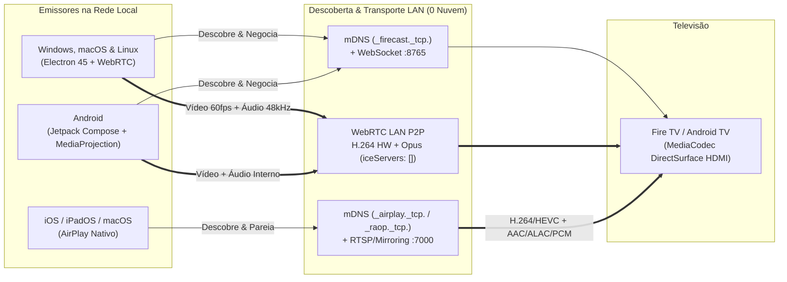

<div align="center">

<a href="https://github.com/EduardoCoura/castviewer">
  
</a>

<br/><br/>

**Espelhamento de tela e áudio 100% em rede local (LAN) via WebRTC P2P e Apple AirPlay — sem nuvem, sem lag, sem cabos e sem driver virtual.**

<br/>

[](https://github.com/EduardoCoura/castviewer/releases/latest)
[](./LICENSE)
[](https://github.com/EduardoCoura/castviewer/actions/workflows/build-macos.yml)
[](https://github.com/EduardoCoura/castviewer/actions/workflows/build-linux.yml)
[](https://github.com/EduardoCoura/castviewer/actions/workflows/build-windows.yml)
[](https://github.com/EduardoCoura/castviewer/actions/workflows/build-android.yml)
[%20%7C%20Fire%20TV-18181D?style=for-the-badge)](#downloads)

<br/>

[Downloads](#-downloads) •
[Por que usar?](#-por-que-o-castviewer) •
[Recursos](#-recursos-por-plataforma) •
[Arquitetura](#-arquitetura-zero-cloud) •
[Roadmap](#%EF%B8%8F-roadmap--implementações-concluídas) •
[Compilar](#%EF%B8%8F-como-compilar-do-código-fonte)

</div>

---

## 🎯 Por que o CastViewer?

Espelhar PC, Mac ou celular na Fire TV normalmente exige nuvem, cabos HDMI, drivers virtuais pesados (como VB-CABLE ou BlackHole) ou sofre com segundos inteiros de atraso. O **CastViewer** resolve isso com uma arquitetura direta dentro do seu próprio Wi-Fi ou cabo de rede:

- **⚡ Latência ultrabaixa (~4 ms na LAN):** vídeo H.264 acelerado por hardware (`MediaCodec` DirectSurface no Fire TV, MediaFoundation/VideoToolbox/VA-API no desktop) e áudio Opus direto via **WebRTC LAN P2P** (`iceServers: []`, zero STUN/TURN externo).
- **🍎 Apple AirPlay nativo no receptor da TV:** conecte **iPhone, iPad e Mac** direto pela **Central de Controle → Espelhar Tela** sem instalar app na App Store — com suporte nativo a H.264 / H.265 (HEVC), áudio AAC-ELD / AAC-LC / ALAC / PCM e ajuste automático de retrato/paisagem na TV.
- **🎧 Áudio interno nativo sem gambiarras:** captura direta do áudio do sistema no **Windows** (WASAPI loopback), **macOS** (ScreenCaptureKit / CoreAudio Tap), **Linux** (PipeWire nativo + fallback `parec`/PulseAudio) e **Android** (`AudioPlaybackCapture`), com botão para silenciar os alto-falantes do computador enquanto transmite.
- **🐧 Sessão Wayland Persistente (`RestoreToken`):** cache de token de sessão PipeWire/XDG ScreenCast (`persist_mode = 2`) sem polling em segundo plano para evitar reconfirmações repetidas no compositor ao alternar fontes ou presets.
- **🔒 Privacidade e controle total:** descoberta automática na LAN via mDNS (`_firecast._tcp.`, `_airplay._tcp.` e `_raop._tcp.`) — nenhum byte sai da sua rede local.
- **🎬 Recursos extras práticos:** troca instantânea entre **Tela** e **Janela** ao vivo sem desconectar, **Clip Replay 30s (MP4)**, **Print instantâneo**, **Pausa com congelamento de quadro**, troca limpa entre **WebRTC e AirPlay** e **Takeover inteligente**.

---

## 📦 Downloads

Baixe o instalador ou pacote pronto para cada dispositivo na [**Release v1.1.0**](https://github.com/EduardoCoura/castviewer/releases/tag/v1.1.0) _(ou veja todas as versões em [Releases](https://github.com/EduardoCoura/castviewer/releases))_:

| Dispositivo | Versão | Pacote / Instalador | Download Direto |
| :--- | :---: | :--- | :--- |
| **Fire TV / Android TV** | `v2.5` | APK Receptor com AirPlay 2/RAOP (obrigatório na TV) | [**`CastViewer-FireTV-v2.5.apk`**](https://github.com/EduardoCoura/castviewer/releases/download/v1.1.0/CastViewer-FireTV-v2.5.apk) |
| **Windows (x64)** | `v1.1.0` | Instalador (`.exe`) • Portátil (`.exe`) | [**Setup `.exe`**](https://github.com/EduardoCoura/castviewer/releases/download/v1.1.0/CastViewer.Setup.1.1.0.exe) • [**Portátil `.exe`**](https://github.com/EduardoCoura/castviewer/releases/download/v1.1.0/CastViewer-Portable-1.1.0.exe) |
| **macOS (Apple Silicon + Intel)** | `v1.1.0` | Universal `.dmg` (`arm64` / `x64`) | [**`CastViewer-macOS-1.1.0-universal.dmg`**](https://github.com/EduardoCoura/castviewer/releases/download/v1.1.0/CastViewer-macOS-1.1.0-universal.dmg) |
| **Linux (x64)** | `v1.1.0` | Universal (`AppImage`) • Debian/Ubuntu (`.deb`) • `.tar.gz` | [**`.AppImage`**](https://github.com/EduardoCoura/castviewer/releases/download/v1.1.0/CastViewer-Linux-1.1.0-x86_64.AppImage) • [**`.deb`**](https://github.com/EduardoCoura/castviewer/releases/download/v1.1.0/CastViewer-Linux-1.1.0-amd64.deb) • [**`.tar.gz`**](https://github.com/EduardoCoura/castviewer/releases/download/v1.1.0/CastViewer-Linux-1.1.0-x64.tar.gz) |
| **Android (Mobile)** | `v1.7.4` | APK Emissor (`Android 8.0+`) | [**`CastViewer-Android-v1.7.4.apk`**](https://github.com/EduardoCoura/castviewer/releases/download/v1.1.0/CastViewer-Android-v1.7.4.apk) |

<details>
<summary><b>🍏 Guia rápido de instalação no macOS (.dmg Universal — Apple Silicon & Intel)</b></summary>

<br/>

1. Baixe `CastViewer-macOS-1.1.0-universal.dmg`, abra a imagem e arraste **CastViewer.app** para **Aplicativos (Applications)**.
2. **Primeira abertura (build open-source sem assinatura paga da Apple):** caso o Gatekeeper exiba aviso de desenvolvedor não identificado, clique com o botão direito em **CastViewer → Abrir** (ou execute no Terminal):
```bash
xattr -cr /Applications/CastViewer.app
```
3. **Permissões recomendadas:** em **Ajustes do Sistema → Privacidade e Segurança**, autorize **Gravação de Tela** e **Captura de Áudio do Sistema** (macOS 14.2+) para espelhar vídeo e áudio interno via ScreenCaptureKit/CoreAudio Tap sem driver virtual. _(Opcionalmente, Macs também podem espelhar nativamente pela Central de Controle usando o receptor AirPlay do Fire TV!)_

</details>

<details>
<summary><b>🐧 Guia rápido de instalação no Linux (Ubuntu, Debian, Fedora, Arch, Mint...)</b></summary>

<br/>

**Opção 1 — Debian / Ubuntu / Pop!_OS / Mint (`.deb`):**
```bash
sudo apt install ./CastViewer-Linux-1.1.0-amd64.deb
castviewer
```

**Opção 2 — Qualquer distro (`AppImage`):**
```bash
chmod +x CastViewer-Linux-1.1.0-x86_64.AppImage
./CastViewer-Linux-1.1.0-x86_64.AppImage
```
> **Dica para Ubuntu 24.04+:** caso o AppArmor restrinja o sandbox local em AppImages, execute com `./CastViewer-Linux-1.1.0-x86_64.AppImage --no-sandbox` ou utilize o pacote `.deb`.

**Notas de Sessão e Áudio:**
- **X11:** prévia e troca direta de telas e janelas na grade da interface.
- **Wayland (PipeWire + `RestoreToken`):** utiliza `WebRTCPipeWireCapturer` com **Wayland Session Persistence** (`persist_mode = 2` e cache local do token/fonte), evitando chamadas em segundo plano ao portal e preservando a seleção ao alternar presets ou fontes — além de card dedicado **"Trocar Tela/Janela (Abrir Portal Wayland)"** para reescolher quando desejar.
- **Áudio do sistema:** captura nativa via PipeWire (`loopback-capture`) com fallback automático para `parec` (PulseAudio), além de silenciamento do PC via `pactl`/`wpctl` e Play/Pause remoto via `playerctl`.

</details>

<details>
<summary><b>📱 Android: Smart View (Sem App) vs. App CastViewer Android</b></summary>

<br/>

- **Posso usar Samsung Smart View / Miracast sem baixar app no celular?**
  - **Sim, usando o receptor nativo da própria Fire TV:** segure o botão **Home** no controle da Fire TV e selecione **Espelhamento** (*Display Mirroring*). O Smart View encontra a Fire TV diretamente via Miracast (Wi-Fi Direct).
  - _Nota técnica:_ o Fire OS / Android restringe a permissão `CONFIGURE_WIFI_DISPLAY` a apps assinados pelo sistema (`signature|privileged`), e o Google Cast exige certificados privados de hardware Google Root CA — por isso um app terceiro GPLv3 sem root não consegue substituir o Miracast ou o Google Cast oficiais dentro do mesmo APK.
- **Quando vale instalar o [`CastViewer-Android-v1.7.4.apk`](https://github.com/EduardoCoura/castviewer/releases/download/v1.1.0/CastViewer-Android-v1.7.4.apk)?**
  - Celulares sem Miracast (ex.: Google Pixel ou aparelhos sem Wi-Fi Direct compatível), redes em que o Wi-Fi Direct trava, ou quando você quer **WebRTC LAN (~4 ms)**, **áudio interno (`AudioPlaybackCapture`)**, **Modo AMOLED**, **Bolha Flutuante**, **Quick Tile** e **Replay 30s**.

</details>

---

## ✨ Recursos por Plataforma

| Plataforma | Módulo | Status | Destaques |
| :--- | :--- | :---: | :--- |
| **Fire TV / Android TV** | [`firestick-app/`](./firestick-app) | ✅ **Ativo (`v2.5`)** | Receptor Kotlin + NDK/JNI com decodificação por hardware (`MediaCodec` H.264/HEVC), QR Code na tela, áudio HDMI (`AudioTrack`), **receptor Apple AirPlay 2/RAOP nativo** e troca automática entre sessões WebRTC e AirPlay. |
| **Windows** | [`desktop-sender/`](./desktop-sender) | ✅ **Ativo (`v1.1.0`)** | Electron 45 com captura DXGI/WGC 1080p60+, áudio loopback WASAPI sem VB-CABLE, mute de alto-falantes, auto-detecção de GPU (NVIDIA/AMD/Intel/Hybrid), Modo PC Fraco/Pouca RAM, Clip Replay 30s MP4 e Play/Pause remoto. |
| **macOS** | [`desktop-sender/`](./desktop-sender) | ✅ **Ativo (`v1.1.0`)** | Binário **Universal `.dmg` (`arm64` + `x64`)**, hardware VideoToolbox, **áudio do sistema nativo** via ScreenCaptureKit/CoreAudio Tap (`NSAudioCaptureUsageDescription`), mute de áudio/Play-Pause nativos via `osascript` e barra/atalhos macOS completos. |
| **Linux** | [`desktop-sender/`](./desktop-sender) | ✅ **Ativo (`v1.1.0`)** | Compatível com **X11 e Wayland/PipeWire com Session Persistence (`RestoreToken`)**, loopback nativo PipeWire + fallback `parec`, mute via `pactl`/`wpctl`, Play/Pause MPRIS, pacotes `.AppImage`, `.deb` e `.tar.gz`. |
| **Android** | [`android-sender/`](./android-sender) | ✅ **Ativo (`v1.7.4`)** | App Jetpack Compose / Material 3 com `MediaProjection` + áudio interno (`AudioPlaybackCapture`), bolha flutuante externa para pausar/encerrar/gravar sobre qualquer app, Modo AMOLED, Quick Tile e Replay 30s. |
| **iOS / iPadOS (via AirPlay)** | [`firestick-app/`](./firestick-app) | ✅ **Ativo no Receptor TV (`v2.5`)** | Espelhamento de tela e áudio direto pela **Central de Controle → Espelhar Tela** no iPhone, iPad ou Mac na mesma rede local — sem instalar nenhum app na App Store (vídeos protegidos por DRM FairPlay em apps como Apple TV+/Netflix continuam bloqueados pelo iOS). |

---

## 🌐 Arquitetura Zero-Cloud



> 📖 Quer entender os detalhes do protocolo de mensagens e identidade visual? Veja [`PROTOCOL.md`](./PROTOCOL.md) e [`DESIGN_SYSTEM.md`](./DESIGN_SYSTEM.md).

---

## 🗺️ Roadmap & Implementações Concluídas

Todas as metas centrais multiplataforma do **CastViewer** foram implementadas na **`v1.1.0` / Fire TV `v2.5`**:

- [x] **🍎 Suporte a iOS / iPadOS / macOS via AirPlay (`firestick-app` v2.5):**
  - Receptor nativo em C/C++ (NDK/JNI sobre Android `MediaCodec` + `AudioTrack`) anunciando `_airplay._tcp.` e `_raop._tcp.` via `NsdManager`, com decodificação por hardware H.264/HEVC, áudio AAC-ELD / AAC-LC / ALAC / PCM e ajuste automático retrato/paisagem na TV. _(Conteúdos protegidos com DRM FairPlay em apps de streaming continuam restritos pelo sistema da Apple.)_
- [x] **🐧 Wayland Session Persistence (`desktop-sender` v1.1.0):**
  - Persistência de `RestoreToken` e opções `persist_mode = 2` no PipeWire/ScreenCast (`wayland-session.js`), eliminação de polling automático no portal, card dedicado para reescolha intencional e preservação de fluxo sem reconfirmações desnecessárias ao alternar fontes ou presets.
- [x] **🍏 macOS Desktop Sender (`desktop-sender` v1.1.0):**
  - Suporte completo a Apple Silicon (`arm64`) e Intel (`x64`) com empacotamento Universal `.dmg`, VideoToolbox, ScreenCaptureKit/CoreAudio system audio loopback, mute/Play-Pause via `osascript`, ícone `.icns`, `entitlements.mac.plist` e pipeline CI em `macos-latest`.

---

## 🛠️ Como Compilar do Código-Fonte

<details>
<summary><b>1. Desktop Sender (Windows, macOS & Linux — Node.js / Electron 45)</b></summary>

```bash
cd desktop-sender
npm install
npm run check

# Build Windows (.exe Setup, Portátil e dir)
npm run dist:win

# Build macOS (Universal .dmg arm64 + x64 — requer macOS)
npm run dist:mac

# Build Linux (.AppImage, .deb e .tar.gz)
npm run dist:linux
```

</details>

<details>
<summary><b>2. Android Sender (Android Studio / Gradle)</b></summary>

```bash
cd android-sender
./gradlew testDebugUnitTest assembleDebug
```

</details>

<details>
<summary><b>3. Fire TV / Android TV Receiver (Gradle + NDK/CMake)</b></summary>

```bash
# Requer Android NDK 27 e CMake 3.22+ (via Android SDK Manager);
# o CMake baixa automaticamente OpenSSL e libplist durante o build.
cd firestick-app
./gradlew testDebugUnitTest assembleDebug
```

</details>

---

## 🤝 Contribuição & Licença

Contribuições, sugestões de melhoria e pull requests são muito bem-vindos!

- Distribuído sob a licença **GNU General Public License v3.0 (GPL-3.0)** — veja o arquivo [`LICENSE`](./LICENSE) para o texto completo.

<div align="center">

<br/>

Se o **CastViewer** ajudou você a espelhar sua tela na Fire TV sem lag, considere deixar uma **⭐ Star** no repositório — isso ajuda muito o projeto a alcançar mais pessoas!

</div>
